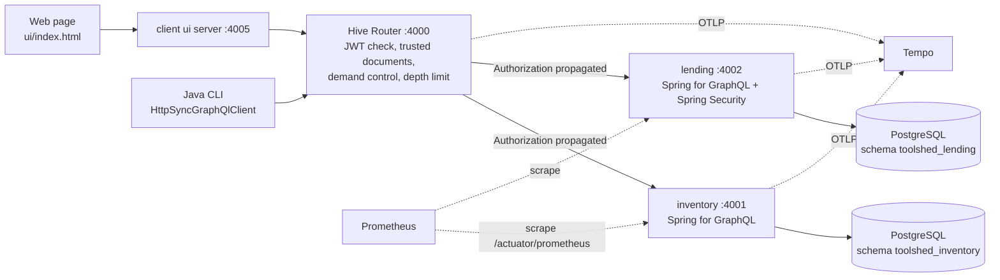

# Toolshed design

Version 1.0.0, 2026-11-23. The contract is `contract/inventory.graphqls` and `contract/lending.graphqls`; the
client's operations are in `operations/`. Decisions with alternatives are in `adr/`.

## Screens and operations

Every operation exists because a screen or a job needs it (Module 7.1: design from the client).

| Screen or job | Operation | Who |
| --- | --- | --- |
| Catalogue, with filter bar and "on the shelf" badges | `ToolPage`, `Filters` | anyone |
| Search box | `Search` | anyone |
| Tool page (from a link or a scanned barcode) | `ToolDetail`, `Availability` (live badge) | anyone |
| Borrow button | `BorrowTool` | members |
| My loans, return button | `MyLoans`, `ReturnTool` | members |
| Librarian's desk: who has this tool? | `DeskLookup`, `ReturnTool` | librarians |
| Weekly overdue report | `OverdueReport` | librarians |

## Architecture

- **inventory** owns what the library has: tools, categories, branches, specs. Read-only for clients.
- **lending** owns who has what: members, loans, availability, the borrow and return mutations, and the
  availability subscription. It knows tools only by id (ADR 0003).
- **The router is the edge** (ADR 0002): clients talk only to it. It checks tokens, runs only persisted
  documents and refuses operations that cost too much. The subgraphs listen on 127.0.0.1 and cannot be
  reached from another machine or container.
- Both subgraphs share one PostgreSQL server but have separate schemas and never read each other's tables.

## Schema

34 named types across the two subgraphs. The entities are `Tool` (key `id`, owned by inventory, extended by
lending with `available` and `currentLoan`) and `Member` (key `id`, owned by lending).

| Kind | Types | Why this kind |
| --- | --- | --- |
| Interface | `ToolSpecs` (`PowerSpecs`, `HandSpecs`); `Problem` (6 failure types) | Shared fields with kind-specific ones; a client can show any `Problem`'s message without knowing every member |
| Union | `SearchResult` (`Tool`, `Category`, `Branch`); `BorrowResult`; `ReturnResult` | Results with nothing in common (search), and success-or-failure results (Module 7.5) |
| `@oneOf` input | `ToolLookup` (`id` or `barcode`) | The desk scans barcodes, links carry ids; exactly one, checked by validation |
| Connection | `ToolConnection`, `LoanConnection` | Cursor pagination over lists that grow |
| Enum | `Condition`, `ToolSort`, `LoanStatus` | Closed sets |
| Scalar | `DateTime` | RFC 3339, always UTC to the second |

In Java the abstract types are sealed interfaces of records (`Model.java` in each subgraph), so a `switch`
over a `BorrowResult` is checked by the compiler and Spring resolves each union member by its class name.

### Naming and references

Fields return objects, not keys (`Loan.tool: Tool!`, not `toolId`). Two exceptions are deliberate:
`ToolNotFound.toolId` and `LoanNotFound.loanId` name something that does not exist, so there is no object to
return. The design lint (Module 7) flags both; this paragraph is the answer.

## Nullability

The rule (Module 7.4): non-null where the product guarantees a value even when part of the system fails;
nullable where absence is meaningful or where a failure must not erase the parent.

- Non-null: ids, names, `Tool.category` and `Tool.branch` (foreign keys, same subgraph, same transaction),
  every connection and its `edges`, every union result. A borrow always has an answer.
- Nullable by meaning: `Query.tool` (no tool with that barcode), `Query.me` (signed out), `Loan.returnedAt`
  (still out), `Tool.currentLoan` (on the shelf), `PageInfo.endCursor` (empty page).
- Nullable for authorization: `Member.email` and `Loan.member`. A member looking at the desk view gets the
  loan with `member: null` and a FORBIDDEN error at that path; if these were non-null, the error would null
  the whole loan and the member would not even learn that the tool is out.
- `Tool.available` is nullable although every tool has an answer, because it comes from another subgraph.
  The first version had `Boolean!`; with lending stopped, the router's error then propagated up through
  `node`, `edges` and `tools` and the whole catalogue came back as `data: null` (probe, 2026-11-23). Now the
  catalogue loads with `available: null` and one error, and the page says "ask at the desk" (ADR 0003).

## Errors

Two kinds, never mixed (ADR 0007):

1. **Expected failures are data.** `borrowTool` returns `BorrowResult`: `Borrowed`, or `ToolUnavailable`
   (with `expectedBack`), `LoanLimitReached` (with `limit`), `ToolNotFound`, `InvalidInput` (with the
   `field`). `returnTool` returns `Returned`, `LoanNotFound` or `AlreadyReturned`. Each failure implements
   `Problem { message }`, so an old client shows a new failure's message without an update.
2. **Request mistakes and access are errors**, with `extensions.classification`: `BAD_REQUEST` (with the
   `argument`, e.g. `first` above 50 or a cursor from another sort order), `UNAUTHORIZED` (signed out, or a bad
   token), `FORBIDDEN` (signed in, not allowed). Unexpected exceptions become `INTERNAL_ERROR` without the
   exception's message (Spring's default). The router adds `code` and `service` and passes the message on.

The router answers HTTP 200 for these, including its own refusals (persisted document missing, cost too
high): clients read `errors`, not the status.

## Pagination, filtering and sorting

Cursor connections (Module 8), keyset in SQL: `tools(first, after, filter, sort)` has one index per sort order
(`lower(name), id` and `added_at, id`), so page 100 costs what page 1 costs. A cursor is the sort key of the
last row, base64url, and names its sort order: a `NEWEST` cursor sent with `NAME_ASC` is a `BAD_REQUEST`
(the integration test caught the first version accepting it). `first` is 1 to 50. `totalCount` is counted
only when selected: one extra statement.

`ToolFilter` is an input of optional fields, all of which must match. Filters exist only where the screens
need them (category, branch, condition, part of the name, power or hand).

## Authorization

- **Authentication** is a bearer JWT from the course's identity provider (Module 10), RS256, issuer
  `http://keycloak:8180/realms/shelfie`, audience `toolshed-api`. The router verifies it offline against
  `router/jwks.json`; lending verifies it again with Spring Security (defence in depth, and the subgraph is
  safe if someone misconfigures the router). No token is anonymous; a bad token is refused.
- **Roles:** `member` (every signed-in member) and `admin` (librarians).
- **Field rules**, in lending's resolvers, checked once per field from a `Caller` resolved once per request:

| Field | Rule |
| --- | --- |
| `Query.me`, `Query.loan` | your own; `loan` of someone else is null (not FORBIDDEN, so ids cannot be probed) |
| `Member.email`, `Member.loans`, `Loan.member` | that member or a librarian; otherwise null and FORBIDDEN |
| `Tool.currentLoan` | signed in |
| `Query.overdueLoans` | librarians |
| `borrowTool` | signed in; `returnTool`: your loan, or any for a librarian (someone else's is `LoanNotFound`) |

## Demand control and trusted documents

- **Trusted documents** (Module 10.5): the router runs only the documents in `router/persisted-documents.json`,
  built from `operations/` by `scripts/persist.sh` (id = SHA-256 of the document). Clients send
  `{"documentId": ...}`. Anything else is `PERSISTED_DOCUMENT_ID_REQUIRED`, introspection included.
- **Cost** (Module 10.4): the router estimates each operation from the schema's `@listSize` and `@cost`
  (IBM cost specification, federation v2.9) and refuses above 2,000. The catalogue page at 12 costs 77, at
  50 258; `OverdueReport` at its defaults 145 and at 50 x 50 about 7,800.
- **Depth** at most 10, and page sizes at most 50 in the resolvers (the cost limit is not the only guard).

Persisted documents make the cost limit a guard against expensive variables, not expensive queries: no client
can send a new query shape at all.

## Real time

`availabilityChanged(toolId)` fires when a tool is borrowed or returned. Clients subscribe through the router
over server-sent events (the router talks to lending over HTTP streaming); lending also accepts
graphql-transport-ws on `/graphql`. Events come from an in-memory sink after the transaction commits, so a
single lending instance is the limit (ADR 0006).

## Concurrency and idempotency

- A partial unique index (`loan (tool_id) WHERE returned_at IS NULL`) makes "one open loan per tool" a
  database fact: the insert is `ON CONFLICT DO NOTHING`, and no row back means `ToolUnavailable`. No read
  before the write, so no race.
- The member's row is locked for the length of a borrow, so the loan limit check and the idempotency check
  cannot race with the member's own parallel requests.
- `idempotencyKey` (ADR 0005): the first answer to (member, key) is stored in the same transaction as the
  loan and returned for any repeat. Keys are per member, so one member's key reveals nothing to another.

## Performance

- Every list field is batched: `Tool.category`, `Tool.branch`, `Category.toolCount` (`@BatchMapping`),
  `Loan.member`, `Tool.currentLoan` (DataLoaders, so authorization can run per item first), and both
  subgraphs' `_entities` take the whole list of representations. A catalogue page runs the same number of
  statements at 2 tools and at 30 (`InventoryGraphQlTest`, and the checker's N+1 probe).
- Load test (docs/LOAD.md): 2,711 requests per second at concurrency 8, p95 under 6 ms, on one 24-core
  machine. 4.81 SQL statements per request one at a time, 2.48 at concurrency 8, because the router merges
  identical in-flight subgraph requests (not across different users' tokens: attack A17).
- No response cache: the catalogue changes rarely, but availability changes every borrow, and the page mixes
  both. A cache would need per-field invalidation; it is not worth it at this size.

## Observability

- Traces: router, inventory and lending export OTLP to Tempo; the router propagates W3C `traceparent`, so one
  request is one trace across three services. Actuator and Spring Security spans are filtered out.
- Metrics: Prometheus scrapes both subgraphs; the dashboard (`ops/dashboard.json`) shows requests and p95 per
  subgraph, SQL statements per request (the N+1 alarm), field errors, borrow results and heap.
- Runbook: `docs/RUNBOOK.md`.

## Testing

| Gate | Where |
| --- | --- |
| Unit tests of the lending rules | `LendingRulesTest` |
| GraphQL tests (GraphQlTester, WebGraphQlTester) on real PostgreSQL (Testcontainers) | `InventoryGraphQlTest`, `LendingGraphQlTest` |
| N+1 detector | `InventoryGraphQlTest.statementsDoNotGrowWithThePage` |
| Schema diff against the released schema | `SchemaCompatibilityTest` (graphql-java SchemaDiff) |
| Mutation testing, 80% threshold | PIT on `LendingRules` (`-Ppit`): 19 of 19 mutants killed |
| Contract conformance through the router | `tests/api.hurl`, 24 requests |
| Attacks | `scripts/attacks.sh`, 18 attacks (docs/ATTACKS.md) |

## Known limits

- One lending instance (subscriptions are in memory).
- The seed is reloaded at every start; there are no migrations (ADR 0004).
- `Member.loans` under `OverdueReport` is one statement per member on the page (at most 50, and the cost limit
  holds the product of the two page sizes).
- The web page was not tested in a browser in the course image (no browser there); its requests are the
  same persisted documents the Hurl suite runs.
