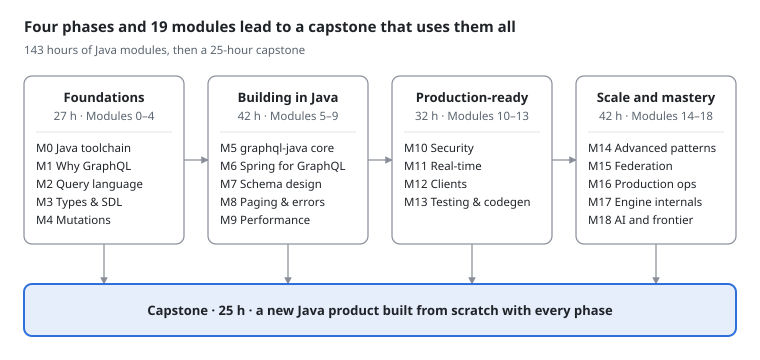

# GraphQL in Java: Zero to Production — Interactive Course Plan

Nov 8, 2026 · @James Bond 007

## Course overview

This is a Java-first GraphQL course: 19 modules, 136 lectures, 60+ experiments, games and mini-projects, and a capstone, about 168 hours in total (143 in modules, 25 in the capstone). Every concept is taught language-neutral first, then built in Java, so the same labs can later be done in Go, TypeScript, Python or any other backend language.

**Who it is for:** Java developers comfortable with classes, records, generics, lambdas, streams and basic Spring or Jakarta EE. No prior GraphQL needed.

**Prerequisites:** Java 17+ (course uses Java 25 LTS, Java 21 also works), Maven, HTTP basics, JSON, basic SQL, Git, Docker.

### The Java stack

| Layer | Primary choice | Also covered |
| --- | --- | --- |
| Language and build | Java 25 LTS, Maven 3.9 with the Maven Wrapper (`./mvnw`) | Java 21, Kotlin side notes; Gradle only where an upstream project forces it (17.7, 18.4) |
| GraphQL engine | [graphql-java](https://github.com/graphql-java/graphql-java) 26 | building your own mini engine (Module 17) |
| Framework | Spring Boot 4 + [Spring for GraphQL](https://spring.io/blog/category/releases) 2.0 | Netflix [DGS](https://netflix.github.io/dgs/spring-graphql-integration) 11, Quarkus + [SmallRye GraphQL](https://quarkus.io/extensions/io.quarkus/quarkus-smallrye-graphql/) (MicroProfile GraphQL), Javalin + raw graphql-java |
| Data loading | java-dataloader, `@BatchMapping` | jOOQ multiset queries, Hibernate fetch plans |
| Persistence | PostgreSQL, Spring Data JPA, Flyway | jOOQ, R2DBC, Redis |
| Async and streams | Virtual threads, `CompletableFuture`, Project Reactor | Kafka, Redis pub/sub |
| Scalars and validation | graphql-java-extended-scalars, extended-validation | Jakarta Bean Validation |
| Clients | `HttpGraphQlClient`, `WebSocketGraphQlClient`, `DgsGraphQlClient` | Apollo Kotlin (JVM, Android), SmallRye typesafe client, plain `java.net.http` |
| Testing | JUnit, `GraphQlTester`, Testcontainers | WireMock, ArchUnit, PIT mutation testing, JMH, Gatling, Hurl |
| Security | Spring Security 7, method security | OAuth 2 resource server, Keycloak |
| Federation | [federation-jvm](https://docs.spring.io/spring-graphql/reference/federation.html) with `@EntityMapping`, DGS | Apollo Router, Hive Router/Gateway, Atlassian Nadel |
| Operations | Micrometer, OpenTelemetry, Actuator | GraalVM native image, Kubernetes |
| AI | Spring AI MCP server | community GraphQL-to-MCP starters |

Versions are pinned in the course repo and re-checked every term. Notable for Java learners: graphql-java 26 now enforces default query limits (depth 100, 100,000 fields) during validation, and Spring for GraphQL 2.0 (GA November 2025) moved to a graphql-java 25+ baseline with JSpecify nullability and nullability checks in schema inspection ([graphql-java 26 notes](https://github.com/apache/karaf/pull/2573), [Spring for GraphQL 2.0 notes](https://github.com/spring-projects/spring-graphql/wiki/Spring-for-GraphQL-2.0)).

**Spec baseline:** the [September 2025 GraphQL spec](https://graphql.org/blog/2025-09-08-september-edition/) and the [GraphQL-over-HTTP spec](https://graphql.github.io/graphql-over-http/draft). Proposals still in flight are taught and labelled; the **Spec and RFC tracker** tab lists every one.

### The running project: Shelfie

You build **Shelfie**, a book-club platform, across the whole course: users, clubs, books, shelves, reviews, meetups and live meetup chat. It naturally needs nesting (N+1 lessons), polymorphism (a mixed activity feed), real-time (chat), big lists (pagination, `@stream`), roles (authorization) and team boundaries (federation). Each module starts from a tagged Git checkpoint.

### Concept first, Java second (the portability rule)

Every lab ships three language-neutral assets so it can be redone in any language later:

1. **Contract:** the `.graphql` schema and the `.graphql` operations for that lab
2. **Conformance tests:** plain-text [Hurl](https://hurl.dev) files that send GraphQL over HTTP and assert on the JSON, so they pass against a Java, Go or TypeScript server alike
3. **Behaviour spec:** a short README describing expected behaviour, not Java classes

The Java solution is one implementation of that contract. The **Language port guide** tab maps every Java library to its Go, TypeScript, Python, Kotlin, C# and Rust equivalent.

### How every lecture runs

1. **Hook (2 min):** a bug, a puzzle or a real company story
2. **Concept (10 to 15 min):** language-neutral explanation and diagrams
3. **Java build (15 to 30 min):** follow-along in the Shelfie repo
4. **Experiment (10 to 30 min):** change one variable and observe — query count, latency, response shape
5. **Check (3 min):** predict-the-output card or quiz

Each module also has at least one **mini-project or game**; the full catalogue of 60+ lives in the **Projects and games** tab, and real-world architectures are in the **Company case studies** tab.

**Assessment:** quizzes (15%), auto-graded labs (25%), mini-projects and games (15%), the Module 10 security CTF (10%) and the capstone (35%).

## Course roadmap

Each phase ends at a working Shelfie checkpoint; the learning tracks near the end of this tab say which modules a shorter path can skip.

## Module 0 — Orientation and the Java toolchain

By the end your JDK, build, IDE and containers work, and you have sent GraphQL from Java with nothing but the JDK. About 3 hours, 4 lectures.

| # | Lecture | Concepts | Java build | Experiment |
| --- | --- | --- | --- | --- |
| 0.1 | Welcome and course map | Shelfie, checkpoints, contracts, Hurl conformance tests, how auto-grading works | Clone the repo, `./mvnw verify`, see red tests | Run one Hurl file against the reference server and against nothing; read both outputs |
| 0.2 | Your Java toolbox | SDKMAN, JDK 25, Maven and the Maven Wrapper (`pom.xml`, lifecycle phases, BOMs), IntelliJ GraphQL plugin, Docker, Testcontainers, GraphiQL 5, Altair, Bruno | `setup-doctor` program, run with `./mvnw exec:java`, that checks every tool | Break one tool on purpose and read the doctor's message |
| 0.3 | First contact | Single endpoint, docs explorer, autocompletion | Query the public [SWAPI GraphQL](https://graphql.org/swapi-graphql/) demo, the Countries API and the GitHub GraphQL API | Ask for 1 field, then 20; compare response sizes |
| 0.4 | One request under the hood | It is an HTTP POST with `query`, `variables`, `operationName` | Send a query from **jshell** using `java.net.http.HttpClient` and Jackson | Send the same query via GET, with a wrong content type, and with no body; record each status code |

**Mini-projects and games**

- **API scavenger hunt:** answer 8 questions about real repos using only the GitHub explorer's docs pane
- **jshell speedrun:** fetch a SWAPI film title in the fewest jshell lines; leaderboard in the course chat

**Spec refs:** [GraphQL-over-HTTP: request parameters and media types](https://graphql.github.io/graphql-over-http/draft)

**Checkpoint:** `checkpoint-00` — doctor green, 3 saved operations, 1 jshell script.

## Module 1 — Why GraphQL exists

By the end you can explain what GraphQL fixes, what it costs, and when REST, gRPC or tRPC is the better call, backed by real company stories. About 3 hours, 5 lectures.

| # | Lecture | Concepts | Java build | Experiment |
| --- | --- | --- | --- | --- |
| 1.1 | Where GraphQL came from | Facebook's 2012 native News Feed rewrite (the feed API only returned HTML), open-sourcing in 2015, the GraphQL Foundation, spec editions 2018, 2021, 2025 | — | Timeline card-sort of 12 milestones |
| 1.2 | The pain it targets | Over-fetching, under-fetching, round-trip waterfalls, endpoint sprawl, versioning churn, mobile networks | Run the provided Spring MVC REST version of a Shelfie club page | Use Toxiproxy to add 700 ms per round trip (PayPal's measured p99 cost) and time the page |
| 1.3 | The mental model | Schema as contract, types as a graph, client-chosen shape, one endpoint, introspection, spec vs implementations | Run the same page against a ready-made GraphQL endpoint | Compare request count, bytes and wall-clock time with 1.2 |
| 1.4 | GraphQL vs REST vs gRPC vs tRPC vs OData | Caching, tooling, typing, streaming, browser reach, team topology, public vs private | Look at one domain as a `@RestController`, a gRPC-java service and a GraphQL controller | Fill a trade-off matrix for 5 scenarios |
| 1.5 | When not to use it, and who does | Simple CRUD, file-heavy or cache-heavy APIs; how GitHub, Shopify, Netflix and Airbnb chose (see the case-studies tab) | — | Read GitHub's 2016 rationale and list its 4 strongest reasons |

**Mini-projects and games**

- **REST or GraphQL? card game:** 20 scenario cards; teams argue for a style, points for the strongest trade-off named
- **Latency lab:** a slider app that shows how page load scales with round trips × latency for REST vs one GraphQL call
- **Debate:** "Our bank should go GraphQL-first for its public API"

**Sources:** [Facebook's 2015 GraphQL announcement](https://engineering.fb.com/2015/09/14/web/graphql-a-data-query-language/), [GitHub's GraphQL API launch](https://github.blog/2016-09-14-the-github-graphql-api/), [PayPal Checkout story](https://medium.com/paypal-engineering/3482f724fb53)

**Checkpoint:** a one-page comparison and the latency-lab numbers in `notes/`.

## Module 2 — The query language, driven from Java

By the end you write any read operation fluently by hand and can treat a GraphQL document as data in Java. About 7 hours, 8 lectures.

| # | Lecture | Concepts | Java build | Experiment |
| --- | --- | --- | --- | --- |
| 2.1 | Anatomy of a query | Operation type and name, selection sets, scalar vs object fields, response mirrors request, `data` / `errors` / `extensions` | Map responses to Java records with Jackson | Remove one field from the query; watch which record field goes null |
| 2.2 | Arguments and variables | Field arguments, variable definitions, defaults, required variables | Build a request with a `Map<String,Object>` of variables | Build the same query with `String.format` and inject `") { __schema { types { name } } } #`; see why variables exist |
| 2.3 | Aliases and multiple root fields | Same field twice with different arguments, response-key collisions | Compare two clubs in one call | Collide two aliases on purpose; read the validation error |
| 2.4 | Fragments | Named and inline fragments, type conditions, cycles (invalid), fragment arguments (RFC, preview only) | Refactor a 60-line query into 4 fragments | Prove output is byte-identical before and after with a JSON diff |
| 2.5 | Directives in operations | `@include`, `@skip`, directive locations incl. variable definitions, custom executable directives | One query serving a compact and a detailed card | Put `@skip` on a subscription root field; read why it is now invalid |
| 2.6 | Introspection | `__schema`, `__type`, `__typename`, how GraphiQL builds docs | Dump a schema to SDL from introspection with graphql-java's `IntrospectionResultToSchema` and `SchemaPrinter` | Introspect 3 public APIs; compare type counts |
| 2.7 | Documents and hygiene | Multiple operations, `operationName`, descriptions on operations (new in September 2025), request `extensions` | A `.graphql` folder for 12 Shelfie operations | Send a two-operation document without `operationName`; read the error |
| 2.8 | Documents as data | Lexer, AST, visitors, printing | graphql-java `Parser`, `NodeVisitorStub`, `AstPrinter` | Write a tiny analyzer that reports depth, field count and alias count for any query |

**Mini-projects and games**

- **GraphQL golf:** fetch a target dataset from the GitHub API in the fewest characters
- **Predict the response:** 10 cards, write the exact JSON before running
- **Fix the broken query:** 12 real validation errors to repair against a timer
- **Mini-project — GitHub profile CLI:** a picocli command that prints a profile card from one query

**Spec refs:** [Language](https://spec.graphql.org/September2025/#sec-Language), [Selection Sets](https://spec.graphql.org/September2025/#sec-Selection-Sets), [Fragments](https://spec.graphql.org/September2025/#sec-Language.Fragments), [Directives](https://spec.graphql.org/September2025/#sec-Language.Directives); RFCs [#1170 operation descriptions](https://rfcs.graphql.org/rfcs/1170/), [#976 request extensions](https://rfcs.graphql.org/rfcs/976/), [#1224 fragment arguments](https://rfcs.graphql.org/rfcs/1224/)

**Checkpoint:** `checkpoint-02` — 12 operations, the analyzer, the CLI.

## Module 3 — The type system and SDL with graphql-java

By the end you can model any domain in SDL, wire it to Java types, and predict exactly how values are coerced. About 8 hours, 9 lectures.

| # | Lecture | Concepts | Java build | Experiment |
| --- | --- | --- | --- | --- |
| 3.1 | SDL and schema building | `schema` and operation types, object types, fields with arguments, descriptions | `SchemaParser` → `TypeDefinitionRegistry` → `RuntimeWiring` → `SchemaGenerator` | Delete one wiring entry; see which field silently returns null |
| 3.2 | Built-in scalars, Java-side | Int is 32-bit, Float is double, ID serialises as String | Map `long` IDs safely | Return `Long.MAX_VALUE` as Int; read the coercion error |
| 3.3 | Custom scalars | Input vs output coercion, `@specifiedBy` | Write a `Coercing` for `ISBN`; use extended-scalars `DateTime`, `Long`, `BigDecimal`, `Url` | Feed 15 bad inputs as literal and as variable; tabulate which path rejects what |
| 3.4 | Nullability and lists | `T`, `T!`, `[T]`, `[T!]`, `[T!]!`, null bubbling | Throw from resolvers at different depths | "Nullability lab": predict where `null` lands, then run |
| 3.5 | Enums | Internal vs external values, evolving enums safely | Bind Java enums, use `EnumValuesProvider` for legacy codes | Add an enum value; check old clients with a strict JSON decoder |
| 3.6 | Interfaces | Shared fields, multiple and nested interfaces | `TypeResolver` implementations | Forget a type resolver; read the startup error |
| 3.7 | Unions and Java sealed types | Unions vs interfaces, `__typename` | Model `FeedItem` as a sealed interface of records; resolve with a pattern-matching `switch` | Add a new record without updating the switch; let the compiler catch it |
| 3.8 | Input types and `@oneOf` | Inputs vs outputs, "exactly one of" arguments, inhabitability | `BookLookup @oneOf { id, isbn, title }` | Try every invalid combination; then write `input A @oneOf { a: A }` and see graphql-java 26 reject it |
| 3.9 | Directives, extensions, deprecation, coordinates | `@deprecated` on fields, arguments, input fields and enum values; `extend type`; schema coordinates; directives on directive definitions (accepted 2026) | Split the schema across 5 `.graphqls` files with extensions | Reference 10 elements by coordinate in a lint config |

**Mini-projects and games**

- **Wireframe to schema:** 4 app screens in, SDL out; diff against a model answer
- **Nullability bets:** bet points on nullable vs non-null for 8 fields, then a failure scenario settles each bet
- **Mini-project — records-to-SDL generator:** a reflection-based tool that turns Java records and sealed interfaces into SDL (your own code-first library in 200 lines)
- **Voyager reveal:** sketch the Shelfie type graph by hand, then compare with GraphQL Voyager's render

**Spec refs:** [Type System](https://spec.graphql.org/September2025/#sec-Type-System); RFCs [#825 OneOf](https://rfcs.graphql.org/rfcs/825/), [#1211 OneOf inhabitability](https://rfcs.graphql.org/rfcs/1211/), [#794 schema coordinates](https://rfcs.graphql.org/rfcs/794/), [#525 deprecating input values](https://rfcs.graphql.org/rfcs/525/), [#1206 directives on directives](https://rfcs.graphql.org/rfcs/1206/), [#649 `@specifiedBy`](https://rfcs.graphql.org/rfcs/649/), [#373 interfaces implementing interfaces](https://rfcs.graphql.org/rfcs/373/)

**Checkpoint:** `checkpoint-03` — full Shelfie SDL (15+ types) and the generator.

## Module 4 — Mutations and input design

By the end your mutations are safe to retry, honest about failure and easy for clients to cache. About 6 hours, 6 lectures.

| # | Lecture | Concepts | Java build | Experiment |
| --- | --- | --- | --- | --- |
| 4.1 | Mutation basics | Root mutation fields run serially, queries may run in parallel; select data back for caches | First mutations against the provided Shelfie API | Log thread and timestamp per root field; prove serial vs parallel order |
| 4.2 | Inputs and payloads | One `input` argument, dedicated payload types, naming (`createReview` vs `reviewCreate`), `clientMutationId` history | Model inputs as Java records | Redesign 5 badly shaped mutations |
| 4.3 | Errors as data | Top-level errors vs domain errors, `userErrors`, result unions | Sealed `CreateReviewResult` with records `ReviewCreated`, `ValidationFailed`, `NotAllowed` | Consume both styles from a Java client; count lines of handling code |
| 4.4 | Idempotency, concurrency, bulk | Idempotency keys, optimistic locking, partial success, long-running jobs that return a job ID | JPA `@Version`, an idempotency-key table, a job pattern with `CompletableFuture` | Fire the same mutation twice concurrently from 50 virtual threads; count duplicates before and after |
| 4.5 | Input validation | Where validation belongs, schema directives vs business rules | Jakarta Bean Validation on input records; graphql-java-extended-validation `@Size`, `@Pattern` | Send 20 invalid inputs; compare where each is rejected and the error shape |
| 4.6 | File uploads | The multipart request convention, CSRF risk, the signed-URL alternative | DGS upload support or the multipart-spring-graphql library; MinIO pre-signed URLs | Upload a 50 MB cover both ways; watch heap with JDK Flight Recorder |

**Mini-projects and games**

- **Chaos button:** a test harness randomly drops responses and duplicates requests; your mutations must stay correct
- **Mini-project — undo everything:** every mutation returns an `undoToken`; build `undo(token)` with the command pattern
- **Design critique cards:** rate 8 real mutation signatures against a rubric

**Spec refs:** [Execution: normal and serial execution](https://spec.graphql.org/September2025/#sec-Execution), [Input Objects](https://spec.graphql.org/September2025/#sec-Type-System); GraphQL multipart request convention (community spec, not part of GraphQL)

**Checkpoint:** `checkpoint-04` — mutation SDL with payloads and typed errors, chaos tests green.

## Module 5 — graphql-java from scratch, no framework

By the end you understand every moving part that Spring and DGS later hide, because you built a spec-compliant server with only graphql-java and the JDK. About 10 hours, 8 lectures.

| # | Lecture | Concepts | Java build | Experiment |
| --- | --- | --- | --- | --- |
| 5.1 | The `GraphQL` object | Parse → validate → execute, the spec response map | `GraphQL.newGraphQL(schema)`, `ExecutionInput`, `ExecutionResult.toSpecification()` | Time each phase separately for a small and a 5,000-field query |
| 5.2 | Data fetchers in depth | Resolver arguments: source, arguments, context, info | `DataFetcher`, `DataFetchingEnvironment` (`getSource`, `getArgument`, `getGraphQlContext`, `getLocalContext`, `getSelectionSet`, `getExecutionStepInfo`), `PropertyDataFetcher`, `DataFetcherResult` | Print an ASCII call tree of every fetcher for a 3-level query |
| 5.3 | Async execution | Parallel siblings, serial mutations, blocking vs non-blocking | `CompletableFuture` fetchers, `AsyncExecutionStrategy`, `AsyncSerialExecutionStrategy`, virtual-thread executors | Make 10 sibling fields each sleep 200 ms; compare platform threads, virtual threads and sync |
| 5.4 | Serving over HTTP yourself | GET vs POST, media types, status codes from GraphQL-over-HTTP | A server on `com.sun.net.httpserver` (then Javalin) | Run the graphql-http audit suite against it; fix every failure |
| 5.5 | Instrumentation | Hooks around parse, validate, execute and each field | Write a timing `Instrumentation`; chain it with `ChainedInstrumentation` | Log fields slower than 50 ms; find the slowest one in Shelfie |
| 5.6 | Exceptions and errors | Field errors vs request errors, error classification, `path` and `locations` | `DataFetcherExceptionHandler`, custom `GraphQLError` | Throw 5 exception types; design the error each should become |
| 5.7 | Wiring options | Schema-first vs programmatic types, the code registry | `GraphQLCodeRegistry`, `GraphQLObjectType` builders, `SchemaTransformer`, `GraphQLSchema.FastBuilder` | Build one schema both ways; benchmark build time for 2,000 types |
| 5.8 | Request plumbing | Context, document caching, cancellation | `GraphQLContext`, `PreparsedDocumentProvider` with Caffeine, request cancellation | Cache parsed documents; measure throughput before and after |

**Mini-projects and games**

- **Mini-project — 150-line GraphQL server:** JDK `HttpServer` + graphql-java, spec-compliant, no other dependency
- **Resolver relay:** in pairs, one writes the schema, the other writes fetchers without seeing intent, then reconcile
- **Spot the bug:** 8 fetchers with classic mistakes (blocking the common pool, shared mutable state, wrong source type, leaking JPA entities)

**Spec refs:** [Execution](https://spec.graphql.org/September2025/#sec-Execution), [Response](https://spec.graphql.org/September2025/#sec-Response), [GraphQL-over-HTTP](https://graphql.github.io/graphql-over-http/draft)

**Checkpoint:** `checkpoint-05` — framework-free Shelfie passing 40 Hurl tests.

## Module 6 — Spring for GraphQL, plus DGS and Quarkus

By the end Shelfie runs on Spring Boot 4 and Spring for GraphQL 2.0, and you have built the same feature in DGS and Quarkus to judge the trade-offs yourself. About 10 hours, 9 lectures.

| # | Lecture | Concepts | Java build | Experiment |
| --- | --- | --- | --- | --- |
| 6.1 | Spring for GraphQL setup | Schema files in `resources/graphql`, GraphiQL, Spring MVC vs WebFlux transports, virtual threads | Port the framework-free server to Boot 4 | Toggle `spring.threads.virtual.enabled`; load-test both |
| 6.2 | Annotated controllers | `@QueryMapping`, `@MutationMapping`, `@SubscriptionMapping`, `@SchemaMapping`, `@Argument`, `@Arguments`, `@ContextValue`, `@LocalContextValue`, projected interfaces | Rewrite every fetcher as a controller method | Use `ArgumentValue<T>` to tell "field omitted" from "explicit null" in a patch mutation |
| 6.3 | Schema mapping inspection | Unmapped fields, unused mappings, nullability mismatches (new in 2.0, JSpecify) | Read the inspection report at startup | Introduce 3 mismatches; make the build fail on them |
| 6.4 | Interception and customisation | Request headers to context, runtime wiring, source builder hooks | `WebGraphQlInterceptor`, `RuntimeWiringConfigurer`, `GraphQlSourceBuilderCustomizer` | Pass a tenant header into `GraphQLContext`; read it in a nested field |
| 6.5 | Spring Data integration | Auto-registered fetchers, Query by Example, Querydsl | `@GraphQlRepository` | Compare generated vs hand-written fetchers for flexibility and SQL emitted |
| 6.6 | Exception handling | Mapping exceptions to GraphQL errors, error types | `@GraphQlExceptionHandler`, `@ControllerAdvice`, `DataFetcherExceptionResolverAdapter` | Map 6 domain exceptions; snapshot the error JSON |
| 6.7 | Netflix DGS | DGS 11 runs on Spring for GraphQL; codegen; mixing programming models | `@DgsComponent`, `@DgsQuery`, `@DgsData`, DGS codegen via the community `graphqlcodegen-maven-plugin` (DGS's own codegen plugin is Gradle-only) | Generate Java types from SDL; break the schema and watch compile errors |
| 6.8 | Quarkus and MicroProfile GraphQL | Code-first schema from Java, CDI, dev mode | `@GraphQLApi`, `@Query`, `@Source` batching, SmallRye typesafe client | Change a Java method signature in dev mode; watch the schema update live |
| 6.9 | Framework bake-off | Choosing a stack | One feature in raw graphql-java, Spring, DGS and Quarkus | Compare lines of code, startup time, memory, p95 latency, test ergonomics |

**Mini-projects and games**

- **Bake-off leaderboard:** the class fills one shared table of the 6.9 numbers
- **Native image race:** build Spring and Quarkus variants with GraalVM; fastest cold start to first GraphQL response wins
- **Mini-project — tiny Javalin GraphQL starter:** package your Module 5 server as a reusable library with an annotation scanner

**Sources:** [Spring for GraphQL 2.0 wiki](https://github.com/spring-projects/spring-graphql/wiki/Spring-for-GraphQL-2.0), [DGS and Spring for GraphQL integration](https://netflix.github.io/dgs/spring-graphql-integration), [DGS versions](https://awesome.ecosyste.ms/projects/github.com%2Fnetflix%2Fdgs-framework), [Quarkus SmallRye GraphQL](https://quarkus.io/blog/supersonic-subatomic-graphql/)

**Checkpoint:** `checkpoint-06` — Shelfie on Spring Boot 4, inspection report clean, bake-off table committed.

## Module 7 — Schema design principles

By the end you can design a schema clients enjoy and that survives years of change without versioning. About 6 hours, 7 lectures.

| # | Lecture | Concepts | Java build | Experiment |
| --- | --- | --- | --- | --- |
| 7.1 | Design from the client | Demand-driven design, thinking in graphs, naming (camelCase fields, PascalCase types, UPPER\_CASE enum values), descriptions as docs | Schema design session: UI needs first, SDL second | Have a teammate build a screen from your SDL alone; count their questions |
| 7.2 | Global object identification | `Node`, opaque global IDs, `node(id:)` / `nodes(ids:)`, refetching | A `GlobalId` record with Base64 encode/decode and a type registry | Refetch 5 different object types through `node(id:)` |
| 7.3 | Modelling relationships | References not foreign keys (`author` not `authorId`), lists vs connections, edge data | Club membership with role and join date on the edge | Remove `authorId` from the schema; update one client |
| 7.4 | Nullability as a decision | When non-null is a promise you can keep, semantic nullability, the `onError` proposal | Audit every field with a checklist | Kill one dependency; see how much of a page survives with your nullability choices |
| 7.5 | Choosing abstract types | Interface vs union vs enum discriminator, future-proofing | Implement the 3 options for one case | Add a fourth variant to each; count client changes |
| 7.6 | Designing for evolution | Additive change, deprecation lifecycle, breaking vs dangerous vs safe | graphql-java `SchemaDiff` in a JUnit test; graphql-inspector in CI | Classify 15 schema changes, then check against the tool |
| 7.7 | Anti-patterns and boundaries | Kitchen-sink `updateUser`, `JSON` escape hatches, raw CRUD exposure, leaking DB names, boolean-flag arguments; aligning types to bounded contexts | Refactor a deliberately bad 200-line schema | Map each Shelfie type to a bounded context (sets up federation) |

**Mini-projects and games**

- **Schema Jenga:** each turn a player proposes a change; others bet whether it breaks a frozen set of old clients; CI settles it
- **Hall of shame:** vote on the worst anti-pattern from real public schemas and present the fix
- **Evolution simulator:** 6 product change requests arrive one by one; ship each with zero client breakage

**Spec refs:** RFCs [Object Identification](https://rfcs.graphql.org/rfcs/ObjectIdentification/), [#1163 error behaviors (`onError`)](https://rfcs.graphql.org/rfcs/1163/), [Semantic Nullability](https://rfcs.graphql.org/rfcs/SemanticNullability/), [#1231 schema valid with deprecated elements removed](https://rfcs.graphql.org/rfcs/1231/), [#997 deprecating object types](https://rfcs.graphql.org/rfcs/997/)

**Checkpoint:** `checkpoint-07` — redesigned schema plus a design decision record (ADR).

## Module 8 — Pagination, filtering, sorting and errors

By the end you serve million-row lists efficiently and give clients a predictable, honest error contract. About 7 hours, 7 lectures.

| # | Lecture | Concepts | Java build | Experiment |
| --- | --- | --- | --- | --- |
| 8.1 | Offset pagination and its limits | `limit` / `offset`, page drift, deep-offset cost | Offset paging with Spring Data `Pageable` | Insert rows mid-scroll; count duplicates and gaps |
| 8.2 | Cursor connections | Relay Connection spec, forward and backward paging, opaque cursors, keyset SQL | Spring for GraphQL connection support: `ScrollSubrange`, `Window`, auto-generated `*Connection` types | Benchmark offset vs keyset at 1 million rows with `EXPLAIN ANALYZE` |
| 8.3 | Filtering, sorting, search | Filter inputs, sort enums, avoiding generic `where`, `totalCount` trade-offs | Specifications or jOOQ conditions from filter records; PostgreSQL full-text search | Property-based tests (jqwik) over 1,000 random filter combinations |
| 8.4 | The error model | Request vs execution errors, `message` / `locations` / `path` / `extensions`, partial data, propagation | Throw at 5 depths | Predict `data` and `errors` before each run |
| 8.5 | Error strategy | Masking unexpected errors, stable codes in `extensions`, typed domain errors, HTTP status under `application/graphql-response+json` | `ErrorType`, a custom `ErrorClassification`, an error-policy interceptor | Send the same failing request with `Accept: application/json` and with `application/graphql-response+json`; compare status codes |
| 8.6 | Partial results on purpose | Returning data and errors together, local context | `DataFetcherResult` with data, errors and `localContext` | Make the reviews service fail; still render the club page |
| 8.7 | Where error handling is heading | `onError` (NULL, PROPAGATE, HALT), semantic non-null, sibling-error rules | Prototype an `onError: NULL` mode with a custom execution strategy (experimental) | Compare cache-friendliness of the two modes in a client test |

**Mini-projects and games**

- **Infinite scroll challenge:** a bot inserts books every second; your client must never show a duplicate
- **Error detective:** 6 production error logs, find the root cause and failing path
- **Mini-project — terminal book browser:** a Lanterna TUI in Java that pages through books with cursors and keyboard arrows

**Spec refs:** [Response: errors](https://spec.graphql.org/September2025/#sec-Response); RFCs [#1163 `onError`](https://rfcs.graphql.org/rfcs/1163/), [#1183 response position and sibling errors](https://rfcs.graphql.org/rfcs/1183/), [#1184 no sibling errors after propagation](https://rfcs.graphql.org/rfcs/1184/), [#1073 strict error paths](https://rfcs.graphql.org/rfcs/1073/), [#1200 schema coordinate on errors](https://rfcs.graphql.org/rfcs/1200/)

**Checkpoint:** `checkpoint-08` — connections, filters and a written error contract.

## Module 9 — Performance and data loading in Java

By the end you can find and kill N+1 queries, pick the right cache, and prove every gain with numbers. About 9 hours, 8 lectures.

| # | Lecture | Concepts | Java build | Experiment |
| --- | --- | --- | --- | --- |
| 9.1 | Seeing N+1 | Naive resolvers multiply DB calls; nesting compounds it | Hibernate SQL logging, datasource-proxy query counter | Count statements for club → members → reviews (expect hundreds) |
| 9.2 | DataLoader from scratch | Batching per tick, memoisation, key ordering, per-key errors | Write a 60-line loader on `CompletableFuture` with manual dispatch | Pass a hidden test suite for ordering, dedupe and error isolation |
| 9.3 | java-dataloader and Spring | `BatchLoader` vs `MappedBatchLoader`, loader context, dispatch strategies, chained loaders | `DataLoaderRegistry`, Spring `BatchLoaderRegistry`, `@BatchMapping` | Same query with no loader, a loader, and `@BatchMapping`; chart statement counts |
| 9.4 | Lookahead and smarter SQL | Selection-set-driven fetching, projections, single-statement trees | `DataFetchingFieldSelectionSet` → JPA entity graphs or jOOQ `MULTISET` | Load the whole club page in one SQL statement; compare with DataLoader |
| 9.5 | Caching layers | Per-request vs entity vs response vs HTTP/CDN caches, per-user keys, invalidation | Caffeine, Redis, a response-cache interceptor, `Cache-Control` on GET | 5 stale-data bugs; find which layer is guilty |
| 9.6 | Persisted queries for speed | APQ hashes, GET for CDN caching, why APQ is not security | graphql-java `ApolloPersistedQuerySupport` with a Caffeine `PersistedQueryCache` | Measure bytes on the wire and hit rate behind a local Varnish |
| 9.7 | Measuring properly | Micro vs load benchmarks, percentiles, flame graphs | JMH, Gatling (or k6), JDK Flight Recorder, async-profiler, Micrometer timers | Produce a before/after report with p50, p95, p99 |
| 9.8 | Engine and JVM tuning | Executors, virtual threads vs Reactor, GC choice, document caching, schema build cost | Tune executor and GC (G1 vs ZGC) | Run the same load under 4 configurations; pick a winner with evidence |

**Mini-projects and games**

- **Performance race:** leaderboard for lowest statement count and lowest p95 on a fixed club-dashboard query
- **Guess the query count:** the instructor shows a query, everyone guesses SQL statements, the counter reveals it
- **Mini-project — N+1 detector:** a JUnit 5 extension that fails any test whose GraphQL operation runs more than N SQL statements

**Spec refs:** none required (performance is implementation-defined); see [Execution](https://spec.graphql.org/September2025/#sec-Execution) for what must stay observable

**Checkpoint:** `checkpoint-09` — loaders everywhere, N+1 detector in CI, performance report committed.

## Module 10 — Security

By the end you can lock a GraphQL API against its own attack surface, not just generic HTTP threats, and prove it with an attack you ran yourself. About 9 hours, 8 lectures.

| # | Lecture | Concepts | Java build | Experiment |
| --- | --- | --- | --- | --- |
| 10.1 | Authentication | Auth belongs at the HTTP layer; sessions vs JWT; OAuth 2 / OIDC; the `viewer` field | Spring Security 7, OAuth 2 resource server, Keycloak in Testcontainers, `@AuthenticationPrincipal` | Call `viewer` with no token, an expired token and a forged token |
| 10.2 | Authorization | Business-layer checks, field-level and row-level rules, leaks through `node(id:)` and connections | `@PreAuthorize` on services, an `@auth(role:)` schema directive via `SchemaDirectiveWiring` | Write tests that try every forbidden path for member, moderator, owner |
| 10.3 | The attack surface | Deep nesting, alias overloading, batched brute force, fragment cycles, field suggestions, introspection exposure, CSRF via GET or simple content types, injection in resolvers | A deliberately vulnerable Shelfie fork | Run each attack and record the server's CPU and memory |
| 10.4 | Demand control | Depth, field-count and cost limits, list caps, timeouts, cost-based rate limits | graphql-java 26 default `QueryComplexityLimits` (depth 100, 100,000 fields), `MaxQueryComplexityInstrumentation` with a `FieldComplexityCalculator`, Bucket4j | Tune limits until the attack suite fails and real Shelfie queries still pass |
| 10.5 | Trusted documents | Build-time allowlists, document IDs, APQ is not trust, introspection in production | Manifest from the client build; enforce via `PreparsedDocumentProvider`; `spring.graphql.schema.introspection.enabled=false` | Replay a captured ad-hoc query against the hardened server |
| 10.6 | Public API security | You cannot allowlist third parties: API keys, scopes, cost budgets, abuse monitoring | Return remaining cost budget in `extensions`, as GitHub and Shopify do | Script a client that spends its budget and backs off correctly |
| 10.7 | Transport and WebSocket security | Auth in `connection_init`, origin checks, CORS, secrets in logs, error-message leakage | A `WebSocketGraphQlInterceptor` that authenticates on init | Open a socket from a hostile origin; confirm rejection |
| 10.8 | Security testing toolkit | graphql-cop, InQL, Clairvoyance (schema recovery even with introspection off), DVGA, OWASP ZAP | Security regression tests in JUnit | Scan your server; fix every finding |

**Mini-projects and games**

- **Capture the flag (graded):** 12 flags in a vulnerable Shelfie — steal a private review, enumerate users, crash a node, bypass a role
- **Red team / blue team:** pairs swap servers, attack for 30 minutes, patch, re-attack
- **Mini-project — cost meter:** a live dashboard showing each client's cost spend per minute, fed from `extensions`

**Sources:** [graphql.org security guide](https://graphql.org/learn/security/), [Golden Path: trusted documents](https://goldenpath.graphql.org/practices/trusted-documents/), [graphql-java 26 release notes](https://github.com/apache/karaf/pull/2573)

**Checkpoint:** `checkpoint-10` — hardened Shelfie, CTF score recorded.

## Module 11 — Real-time and incremental delivery

By the end Shelfie has live meetup chat that scales across instances, a deferred club page, and you can pick the right real-time tool per feature. About 8 hours, 7 lectures.

| # | Lecture | Concepts | Java build | Experiment |
| --- | --- | --- | --- | --- |
| 11.1 | Subscriptions, conceptually | Source stream vs response stream, one root field, errors in the source stream | Diagram one chat message from mutation to every subscriber | Error the source stream mid-flight; see what the client receives |
| 11.2 | Transports | graphql-ws over WebSocket, Server-Sent Events, RSocket, multipart HTTP | Spring for GraphQL WebSocket and SSE transports | Open the same subscription over both; inspect frames and reconnect behaviour |
| 11.3 | Implementing subscriptions | Streams, filtering per subscriber, backpressure, cleanup | `@SubscriptionMapping` returning `Flux`, Reactor `Sinks.Many`, `takeUntil` cleanup | A "someone is typing" indicator; flood it with 10,000 events/s and watch backpressure |
| 11.4 | Scaling fan-out | Pub/sub across instances, sticky sessions, delivery guarantees | Redis pub/sub, then Kafka via Spring for Apache Kafka | 3 replicas behind a load balancer; prove every client gets every message |
| 11.5 | Alternatives to subscriptions | Polling, live queries, webhooks, change data capture | Debezium CDC from PostgreSQL feeding a subscription | Compare server load for polling every 2 s vs subscriptions for 500 clients |
| 11.6 | `@defer` and `@stream` | Prioritising critical data, the incremental payload format (`pending`, `incremental`, `completed`, `hasNext`), `multipart/mixed` | graphql-java experimental incremental support (enable via `ExperimentalApi.ENABLE_INCREMENTAL_SUPPORT`) | Defer a slow recommendations panel; measure time to first byte and first paint |
| 11.7 | Choosing the right tool | Cost and complexity of each option | Decision matrix for 6 Shelfie features | Defend one choice in a 2-minute pitch |

**Mini-projects and games**

- **Mini-project — live trivia game:** a Kahoot-style quiz; questions pushed by subscription, answers by mutation, a live leaderboard
- **Multiplayer tic-tac-toe:** two players, moves as mutations, board updates as subscriptions, spectators welcome
- **Classroom chat stress test:** every learner's server joins one room; the instructor kills instances to test resilience

**Spec refs:** [Subscriptions in Execution](https://spec.graphql.org/September2025/#sec-Execution); RFCs [#1110 incremental delivery (RFC 2)](https://rfcs.graphql.org/rfcs/1110/), [#1127 source-stream errors](https://rfcs.graphql.org/rfcs/1127/), [#860 no `@skip`/`@include` on subscription root](https://rfcs.graphql.org/rfcs/860/). graphql-java's `@defer` support is experimental and `@stream` lags it; check the release notes for the version you pin ([graphql-java 26 notes](https://github.com/apache/karaf/pull/2573), [Spring examples](https://github.com/spring-projects/spring-graphql-examples)).

**Checkpoint:** `checkpoint-11` — chat on 3 replicas, deferred club page, trivia game playable.

## Module 12 — Clients: Java first, then web and mobile

By the end you can consume GraphQL from Java services, understand normalised caching well enough to build one, and know how web and mobile clients differ. About 8 hours, 8 lectures.

| # | Lecture | Concepts | Java build | Experiment |
| --- | --- | --- | --- | --- |
| 12.1 | What a client really does | Transport, documents, variables, decoding, caching, dedupe, retries | A minimal client on `java.net.http` + Jackson | List what you had to hand-write; that list is the case for a library |
| 12.2 | Spring's GraphQL clients | Documents as files, typed decoding, interceptors, sync vs reactive | `HttpSyncGraphQlClient`, `HttpGraphQlClient`, `WebSocketGraphQlClient`, `retrieve(...).toEntity(...)` | Call Shelfie from a second Spring service; subscribe to chat from it |
| 12.3 | Type-safe Java clients | Generated projections, compile-time safety | DGS codegen client API with `DgsGraphQlClient` (multi-query support in Spring for GraphQL 2.0) | Rename a schema field; watch the client fail to compile, not at runtime |
| 12.4 | MicroProfile clients | Typesafe (interface-based) and dynamic (builder) clients | SmallRye GraphQL client in Quarkus | Write the same call both ways; compare readability |
| 12.5 | Normalised caching | Cache IDs (`__typename` + `id`), field policies, merging pages, cache updates after mutations, optimistic UI | Build a 300-line normalised cache in Java | Update a book title once; prove every cached query sees it |
| 12.6 | Web clients (overview track) | Apollo Client, urql, Relay; fragment colocation and data masking | Optional React lab against your Java server | Same screen in Apollo Client and Relay; compare re-render counts |
| 12.7 | Mobile clients | Apollo Kotlin codegen, normalised cache on Android, offline | Optional Android lab with Apollo Kotlin | Airplane-mode test: read from cache, queue a mutation |
| 12.8 | Client resilience | Timeouts, retries with backoff, idempotent replays, persisted documents from clients | Resilience4j around `GraphQlClient` | Inject 30% failures with Toxiproxy; measure success rate before and after |

**Mini-projects and games**

- **Mini-project — build your own normalised cache:** pass a test suite of 25 cache scenarios
- **Mini-project — Shelfie CLI:** a JLine-powered terminal client with autocomplete driven by introspection
- **Same screen, three clients:** one feature in Spring client, Apollo Kotlin and a web client; write a one-page comparison

**Sources:** [Spring for GraphQL 2.0 release coverage](https://www.infoq.com/news/2025/11/spring-news-roundup-nov17-2025), [Quarkus GraphQL clients](https://quarkus.io/blog/supersonic-subatomic-graphql/)

**Checkpoint:** `checkpoint-12` — two Java clients and the cache, all tested.

## Module 13 — Testing, tooling and code generation

By the end every Shelfie change passes unit, integration, contract, schema-compatibility and mutation tests in CI. About 7 hours, 7 lectures.

| # | Lecture | Concepts | Java build | Experiment |
| --- | --- | --- | --- | --- |
| 13.1 | Unit tests | Testing business logic apart from GraphQL; slice tests | JUnit, Mockito, `@GraphQlTest` | Delete a resolver's logic; which tests notice? |
| 13.2 | GraphQL-aware tests | Document files, path assertions, error assertions, subscriptions in tests | `ExecutionGraphQlServiceTester`, `HttpGraphQlTester`, `WebSocketGraphQlTester`; DGS `DgsQueryExecutor` | Assert a subscription emits exactly 3 events in order |
| 13.3 | Integration and contract tests | Real dependencies, black-box contracts | Testcontainers (PostgreSQL, Kafka, Keycloak), the Hurl conformance suite | Run the same Hurl suite against the Module 5 and Module 6 servers |
| 13.4 | Mocking | Schema-driven mocks, mocking downstream GraphQL services | A `WiringFactory` that returns fake data for any type; WireMock for downstream APIs | Build a new screen against mocks only, then switch to the real server with zero changes |
| 13.5 | Schema checks in CI | Snapshots, breaking-change detection, operation validation against the schema | graphql-java `SchemaDiff` test, graphql-inspector in GitHub Actions, registry checks (Hive, GraphOS) | Open a PR with a breaking change; the pipeline must explain why it failed |
| 13.6 | Linting and architecture rules | Naming, required descriptions, banned patterns, layering | graphql-eslint (language-neutral), Spotless, ArchUnit rules (controllers never touch repositories) | Introduce 5 violations; see which tool catches each |
| 13.7 | Code generation and dev tooling | Schema-to-types, client projections, IDE support, docs sites | DGS codegen with `graphqlcodegen-maven-plugin`, IntelliJ GraphQL plugin + `graphql.config.yml`, GraphQL Voyager, SpectaQL or Magidoc | Publish a browsable docs site for the Shelfie schema |

**Mini-projects and games**

- **Mutation testing tournament:** PIT injects bugs into your resolvers; highest kill rate wins (target 80%)
- **Break the build:** each learner hides one sneaky breaking change; others must spot it before CI does
- **Mini-project — schema-driven mock server:** a standalone jar that serves realistic fake data for any SDL file you give it

**Spec refs:** [Validation](https://spec.graphql.org/September2025/#sec-Validation) (validating client documents in CI), RFC [MockSpec — response mocking](https://rfcs.graphql.org/rfcs/MockSpec/)

**Checkpoint:** `checkpoint-13` — green pipeline with every gate above.

## Module 14 — Advanced schema patterns and integrations

By the end you can handle the real-world requirements most courses skip: custom directives, locales, tenants, legacy backends, events, privacy and schemas built at runtime. About 8 hours, 7 lectures.

| # | Lecture | Concepts | Java build | Experiment |
| --- | --- | --- | --- | --- |
| 14.1 | Custom schema directives | Behaviour declared in SDL vs code | `SchemaDirectiveWiring` for `@uppercase`, `@mask` (PII), `@currency(code:)` | Stack two directives on one field; does order matter? |
| 14.2 | Locales, time zones, money | `Accept-Language`, localised fields, time-zone-safe scalars, money as amount + currency | `Locale` controller argument, extended-scalars `DateTime`, a `Money` type | Request the same book in 3 locales and 3 time zones |
| 14.3 | Multi-tenancy | Tenant from header or token, isolation, per-tenant schema visibility | Tenant in `GraphQLContext`, PostgreSQL row-level security, schema visibility per tenant | Try to read tenant B's data as tenant A through 6 different paths |
| 14.4 | GraphQL over existing systems | Backend-for-frontend, wrapping REST, gRPC and SOAP, resilience | `RestClient`, grpc-java stubs, Resilience4j | Wrap the public Open Library REST API as `Book.openLibraryInfo`; kill it and keep the page working |
| 14.5 | Events and CQRS | Mutations as commands, read models, eventual consistency visible in the schema | Spring for Apache Kafka, an outbox table, a projection updater | Create a review and query it within 10 ms and after 1 s; expose a `pending` status honestly |
| 14.6 | Auditing, soft delete, privacy | Who changed what, GDPR erase, PII masking, data retention | Audit `Instrumentation`, a `deleteMyAccount` mutation, `@mask` | Run an erase request; verify nothing personal remains in DB, logs or caches |
| 14.7 | Dynamic and multiple schemas | Schemas from metadata, hot reload, several endpoints in one JVM | Build a `GraphQLSchema` from a metadata table at runtime; Spring standalone setup for a second endpoint | Add a column in the admin table; see the new field appear without a restart |

**Mini-projects and games**

- **Mini-project — headless CMS in a weekend:** content types defined in a table become GraphQL types at runtime
- **Directive zoo:** each learner invents one playful directive (`@pirate`, `@emojify`, `@redactOnFridays`) and demos it
- **Mini-project — Open Library gateway:** one GraphQL API over a third-party REST API, with caching and graceful failure

**Spec refs:** [Directives in the type system](https://spec.graphql.org/September2025/#sec-Type-System); RFCs [#472 repeatable directives](https://rfcs.graphql.org/rfcs/472/), [Metadata directives](https://rfcs.graphql.org/rfcs/wg1096/)

**Checkpoint:** `checkpoint-14` — directives, tenants and the Open Library gateway in Shelfie.

## Module 15 — Federation and distributed graphs on the JVM

By the end Shelfie is four Java subgraphs behind a router, you can read a query plan, and you know the Netflix-style path from monolith to federated graph. About 9 hours, 7 lectures.

| # | Lecture | Concepts | Java build | Experiment |
| --- | --- | --- | --- | --- |
| 15.1 | One graph, many teams | Monolith vs BFF vs distributed graph, Conway's law, Netflix's Studio migration | Map Shelfie's bounded contexts to teams | Estimate coordination cost of one feature under each model |
| 15.2 | Stitching and hydration | Gateway-side linking vs subgraph-side linking | Atlassian Nadel hydration (Kotlin, JVM) over two services | Rename a field at the gateway; note who owns that decision |
| 15.3 | Federation concepts | Entities, `@key`, `@shareable`, `@external`, `@requires`, `@provides`, `@override` (incl. progressive), `@inaccessible`, `@interfaceObject`, `@tag`, `_entities`, `_service` | Annotated SDL for accounts, catalog, reviews, clubs | Remove a `@key`; read the composition error |
| 15.4 | Java subgraphs | Entity resolution, batching entity lookups | Spring for GraphQL `FederationSchemaFactory` + `@EntityMapping` (single, `List`, and `DataLoader` forms); the DGS equivalent | Count `_entities` calls with and without batched `@EntityMapping` |
| 15.5 | Composition and query plans | Supergraph SDL, composition hints, plan reading, cross-subgraph N+1 | Compose with Rover or Hive CLI in CI | Predict the subgraph call sequence for 5 queries; compare with the router's plan |
| 15.6 | Routers and gateways | Apollo Router, Hive Router (Rust), Hive Gateway, WunderGraph Cosmo, Hot Chocolate Fusion; JVM-native gateways (Nadel, feddi in development) | Run the supergraph on 2 routers | Compare latency, memory and config for the same traffic |
| 15.7 | Operating a federated graph | Auth propagation, subscriptions and `@defer` through a router, zero-downtime `@override` migration, contracts, the GraphQL Foundation's Composite Schemas spec | Header propagation config; a migration runbook | Move `Review.book` between subgraphs with traffic flowing and zero errors |

**Mini-projects and games**

- **Team simulation:** groups of 4 each own one subgraph and must ship "club book of the month" together under a deadline
- **Query-plan puzzle:** predict plans, score points for exact matches
- **Polyglot preview:** one subgraph re-implemented in Kotlin with graphql-kotlin (Expedia) must still compose

**Sources:** [Spring for GraphQL federation docs](https://docs.spring.io/spring-graphql/reference/federation.html), [Netflix federation story (InfoQ)](https://www.infoq.com/articles/federated-GraphQL-platform-Netflix), [Atlassian Nadel](https://github.com/atlassian-labs/nadel), [Composite Schemas roadmap](https://github.com/graphql/composite-schemas-spec/blob/main/ROADMAP.md), [The Guild federation stack](https://the-guild.dev/graphql/hive/ecosystem), [graphql-java site (feddi)](https://github.com/graphql-java/graphql-java-page/pull/203)

**Checkpoint:** `checkpoint-15` — four subgraphs, one router, `docker compose up` in one command.

## Module 16 — Running GraphQL in production

By the end Shelfie is deployed, traced, governed and has an on-call runbook, and you can remove a field safely using real usage data. About 8 hours, 7 lectures.

| # | Lecture | Concepts | Java build | Experiment |
| --- | --- | --- | --- | --- |
| 16.1 | Observability | Why one endpoint breaks naive HTTP dashboards; metrics by operation and client; traces per field | Micrometer Observation (request and data-fetcher observations), OpenTelemetry Java agent, Grafana + Tempo | Find the slowest field from traces alone |
| 16.2 | Registry and field analytics | Publishing schemas, client name and version headers, field-level usage | Report usage to Hive (or GraphOS / Cosmo) from an `Instrumentation` | List fields no client used in 7 days of simulated traffic |
| 16.3 | Governance | Style guides, review boards vs automated checks, ownership metadata, deprecate → measure → remove | A schema-review GitHub template and CODEOWNERS per type | Remove a deprecated field end-to-end with usage data as proof |
| 16.4 | Deployment | Containers, Kubernetes probes, graceful shutdown with open subscriptions, config, native images | Jib Maven plugin or Buildpacks (`spring-boot:build-image`), Actuator health groups, GraalVM native image, CRaC | Roll a deploy while 200 subscriptions are open; count dropped messages |
| 16.5 | Reliability | Per-field timeouts, bulkheads, circuit breakers, load shedding, graceful degradation | Resilience4j, request cancellation in graphql-java | Kill the reviews dependency at peak; keep p95 under target |
| 16.6 | Capacity and cost | Autoscaling signals, cost-aware throttling, edge caching, multi-region reads | HPA on a custom cost metric | Find the request rate where p99 breaks; add one optimisation; repeat |
| 16.7 | GraphQL as a public product | Docs, changelogs, dated release cycles (as Shopify does), SDKs, sandboxes, migration guides | A public changelog page and migration guide | Write and peer-review one breaking-change announcement |

**Mini-projects and games**

- **Incident game day:** 3 injected faults (slow subgraph, subscription memory leak, abusive client); diagnose with traces and metrics only
- **Governance council:** role-play a schema review deciding on 4 proposed changes
- **Mini-project — GraphQL ops dashboard:** a Grafana board with top operations, error rate by code, slowest fields and cost per client

**Sources:** [Shopify's GraphQL-first API strategy](https://www.shopify.com/partners/blog/all-in-on-graphql), [Netflix federated platform (InfoQ)](https://www.infoq.com/articles/federated-GraphQL-platform-Netflix)

**Checkpoint:** `checkpoint-16` — deployed, observable Shelfie with runbook and dashboard.

## Module 17 — Under the hood: spec, parser and executor in Java

By the end you have written a small GraphQL engine in modern Java and can settle "is this standard or a library quirk?" by reading the spec. About 10 hours, 8 lectures.

| # | Lecture | Concepts | Java build | Experiment |
| --- | --- | --- | --- | --- |
| 17.1 | Reading the spec and the RFC process | Six parts (Language, Type System, Introspection, Validation, Execution, Response), algorithm notation, RFC stages 0 to 3, working groups | — | Find the spec text behind 5 behaviours seen earlier in the course |
| 17.2 | Lexer | Tokens, block strings, full Unicode (RFC #849), greedy lexing | Sealed `Token` interface with record variants | Differential test: your lexer vs graphql-java on 1,000 documents |
| 17.3 | Parser and AST | Recursive descent, AST records, locations | Record-based AST, `switch` pattern matching visitors | Fuzz your parser and graphql-java's with Jazzer; investigate every disagreement |
| 17.4 | Validation | Fields on correct type, known arguments, unused variables, fragment cycles, variables in allowed position, overlapping fields can be merged | Implement 6 rules | Feed 40 invalid documents; match graphql-java's error count |
| 17.5 | Execution | `CollectFields`, `ExecuteSelectionSet`, `CompleteValue`, argument coercion, serial vs parallel, null propagation | A mini executor on virtual threads | Pass 30 conformance tests; then run the Module 2 queries on your engine |
| 17.6 | Introspection and printing | Introspection as a schema, SDL printing, round-trips | Add `__schema` / `__type` to your engine | SDL → schema → introspection → SDL; diff the output |
| 17.7 | graphql-java internals tour | Parser, `OperationValidator`, execution strategies, `ValueUnboxer`, instrumentation hooks | Read and annotate 5 core classes; run graphql-java's own tests | Make a one-line change, build graphql-java locally (its own build uses the Gradle wrapper: `./gradlew publishToMavenLocal`), use it from Shelfie's `pom.xml` |
| 17.8 | GraphQL-over-HTTP in depth | Encodings, GET only for queries, `application/graphql-response+json` vs `application/json`, status codes, batching (not standard), persisted-documents work | Make your Module 5 server fully compliant | Run the graphql-http audit to 100% |

**Mini-projects and games**

- **Build-from-scratch (graded):** your lexer, parser, validator and executor in under 2,000 lines of Java
- **Spec scavenger hunt:** 15 questions answerable only from the spec text, against the clock
- **Mock working group:** propose a tiny spec change as an RFC; peers play champion, skeptic and implementer

**Spec refs:** [Language](https://spec.graphql.org/September2025/#sec-Language), [Validation](https://spec.graphql.org/September2025/#sec-Validation), [Execution](https://spec.graphql.org/September2025/#sec-Execution), [Introspection](https://spec.graphql.org/September2025/#sec-Introspection), [Response](https://spec.graphql.org/September2025/#sec-Response), [GraphQL-over-HTTP](https://graphql.github.io/graphql-over-http/draft); RFCs [#849 full Unicode](https://rfcs.graphql.org/rfcs/849/), [#1058 list coercion](https://rfcs.graphql.org/rfcs/1058/), [#1179 CoerceInputValue](https://rfcs.graphql.org/rfcs/1179/), [#1177 meta-fields in execution](https://rfcs.graphql.org/rfcs/1177/), [#1227 empty selection sets](https://rfcs.graphql.org/rfcs/1227/)

**Checkpoint:** `checkpoint-17` — your engine, its fuzz report, and a 100% HTTP audit.

## Module 18 — The frontier: AI agents, open RFCs and other languages

By the end you can expose a graph safely to AI agents from Java, follow where the spec is heading, and port a Shelfie subgraph to another language. About 7 hours, 6 lectures.

| # | Lecture | Concepts | Java build | Experiment |
| --- | --- | --- | --- | --- |
| 18.1 | GraphQL for AI agents | Schemas as machine-readable context, operation descriptions (September 2025) as tool docs, risks of LLM-written queries | Add descriptions to 10 Shelfie operations | Let an LLM write queries for 10 questions; score validity and cost |
| 18.2 | An MCP server in Java | Curated operations as MCP tools vs raw "execute anything" | Spring AI MCP server with `@Tool` methods that run persisted operations through `GraphQlClient` | Connect it to an MCP-capable assistant; ask "which club read the most books last month?" |
| 18.3 | Agent safety | Read-only defaults, allowlists, cost caps, human approval for mutations, auth passthrough | Policy layer in front of the tools | Try to make the agent run a destructive mutation; block it |
| 18.4 | Platforms beyond hand-built servers | Database-generated APIs (PostGraphile, Hasura, Supabase pg\_graphql, Neo4j GraphQL Library), graph databases with GraphQL (Dgraph), Airbnb's Viaduct (JVM, open source), graphql-kotlin | Generate an API from the Shelfie DB; run Viaduct's starter (Gradle-based upstream; run it with its wrapper) | List what you would still need to hand-build for production |
| 18.5 | Where the spec is heading | Incremental delivery, `onError`, fragment arguments, service capabilities, Full Schemas, Composite Schemas, persisted documents in GraphQL-over-HTTP | Read 2 open RFCs end to end | Write a 300-word explainer for the class wiki |
| 18.6 | Porting to another language | The contract and Hurl suite as the source of truth | Port one subgraph to Go (gqlgen) or TypeScript (Yoga + Pothos) | It must pass the same Hurl suite and compose in the same supergraph |

**Mini-projects and games**

- **Agent safety lab:** red-team your own MCP server; points for every bypass found and fixed
- **Polyglot day:** the class composes one supergraph from 5+ languages
- **Lightning talks:** 5 minutes on one RFC or ecosystem tool

**Sources:** [Apollo MCP Server](https://www.apollographql.com/docs/deploy-preview/4359c3e2360f58d875132c93/apollo-mcp-server) (reference design), [Spring AI MCP tools](https://livebook.manning.com/learn/concepts/toolcallbackprovider--api-element/spring-ai-in-action), [Airbnb Viaduct](https://airbnb.tech/data/viaduct-five-years-on-modernizing-the-data-oriented-service-mesh/), [RFC tracker](https://rfcs.graphql.org/rfcs/); RFCs [#1208 service capabilities](https://rfcs.graphql.org/rfcs/1208/), [Full Schemas](https://rfcs.graphql.org/rfcs/FullSchemas/)

**Checkpoint:** `checkpoint-18` — MCP server with a safety policy, one ported subgraph.

## Capstone and assessment

The capstone is a new product built in Java from an empty repo in about 25 hours, proving you can make every design decision yourself. Pick a brief below, one from the **Projects and games** tab's capstone-grade list, or pitch your own.

| Brief | Domain | Why it stretches you |
| --- | --- | --- |
| Event ticketing | Venues, events, seat holds, orders, a live seat map | Concurrency on seat holds, real-time availability, payment results as typed errors |
| Multiplayer quiz platform | Rooms, questions, answers, live leaderboards | Subscriptions at scale, anti-cheat authorization, `@defer` for results |
| Food delivery | Restaurants, menus, carts, orders, courier tracking | Federation across 3+ domains, location streams, heavy reads |
| Team task tracker | Workspaces, projects, tasks, comments, activity feed | Deep authorization, multi-tenancy, polymorphic feed |
| Your own idea | Approved via a one-page pitch | Must meet the requirement list below |

### Required in every capstone

- [ ] Design doc: schema, architecture diagram, nullability and error strategy, auth model, ADRs
- [ ] Contract-first: `.graphqls` schema, operations folder and a Hurl conformance suite
- [ ] At least 15 types including an interface, a union (sealed Java types) and a `@oneOf` input
- [ ] Cursor connections with filtering and sorting
- [ ] Mutations with typed errors and idempotency where it matters
- [ ] One real-time feature (subscription or `@defer`)
- [ ] DataLoader or `@BatchMapping`; the N+1 detector green in CI
- [ ] Spring Security auth, field-level authorization, cost limits, trusted documents
- [ ] A Java client (Spring `GraphQlClient` or DGS codegen client) plus one UI of any kind
- [ ] CI with unit, `GraphQlTester`, Testcontainers, schema-diff and PIT gates
- [ ] At least 2 subgraphs composed behind a router
- [ ] Micrometer/OpenTelemetry tracing, a Grafana dashboard and a runbook
- [ ] A 10-minute demo and live Q&A

### Stages

1. **Stage 1:** pitch, design doc and contract, peer-reviewed against the Module 7 rubric
2. **Stage 2:** working API with core operations, Hurl suite green
3. **Stage 3:** client, real-time, performance and security hardening
4. **Stage 4:** federation, observability, demo day

### Capstone rubric

| Area | Weight | Full marks look like |
| --- | --- | --- |
| Schema design | 20% | Client-driven, consistent, sensible nullability, evolvable |
| Correctness and tests | 15% | Meaningful coverage, all CI gates, no failing paths in the demo |
| Performance | 15% | No N+1, justified caching, load-test evidence |
| Security | 15% | Tested auth rules, demand control, trusted documents, a self-run attack report |
| Java craft | 10% | Idiomatic modern Java (records, sealed types, virtual threads where they help), clean layering |
| Architecture and ops | 15% | Clear subgraph boundaries, tracing, runbook |
| Communication | 10% | Clear doc and demo, honest trade-offs |

Grade weights overall: quizzes 15%, auto-graded labs 25%, mini-projects and games 15%, security CTF 10%, capstone 35%.

## Pacing, learning tracks and core references

The full course is about 143 hours of modules plus a 25-hour capstone; shorter tracks cut it to 57 to 101 hours.

### Pacing options

| Pace | Hours per week | Modules | Capstone | Total |
| --- | --- | --- | --- | --- |
| Intensive bootcamp | 35 | about 4 weeks | 1 week | about 5 weeks |
| Part-time | 10 | about 15 weeks | 3 weeks | about 18 weeks |
| Weekends only | 5 | about 29 weeks | 5 weeks | about 8 months |

### Learning tracks

| Track | Modules | Approx. hours | Capstone focus |
| --- | --- | --- | --- |
| Spring developer fast track | 0, 2, 3, 4, 6, 8, 9, 10 | 59 | A secured, fast single Spring service |
| API consumer (Java clients) | 0–4, 8, 11, 12, 13 | 57 | A typed Java client and CLI against a public API |
| Java backend core | 0–11, 13, 16 | 101 | API, performance, security, operations |
| Platform / architect | All 19 | 143 | Federation, governance, observability, AI access |

### Weekly rhythm (part-time)

- **Two lecture sessions** of about 90 minutes: concept, Java build, experiment
- **One lab hour:** solo challenges against the Hurl suite and JUnit tests
- **One play session:** the module's game, review or CTF round
- **Hints, not answers:** every challenge has 3 escalating hints in a `HINTS.md`

### Core references

- [GraphQL spec, September 2025](https://graphql.org/blog/2025-09-08-september-edition/), the [RFC tracker](https://rfcs.graphql.org/rfcs/) and the [GraphQL-over-HTTP spec](https://graphql.github.io/graphql-over-http/draft)
- [graphql.org security guide](https://graphql.org/learn/security/) and the [GraphQL Golden Path](https://goldenpath.graphql.org/practices/trusted-documents/)
- [graphql-java](https://github.com/graphql-java/graphql-java), [Spring for GraphQL federation reference](https://docs.spring.io/spring-graphql/reference/federation.html), [DGS docs](https://netflix.github.io/dgs/spring-graphql-integration), [Quarkus SmallRye GraphQL](https://quarkus.io/extensions/io.quarkus/quarkus-smallrye-graphql/)
- Books: *GraphQL with Java and Spring* (graphql-java maintainers), *Production Ready GraphQL* (Marc-André Giroux), *Learning GraphQL* (Eve Porcello, Alex Banks)

### Cheat sheets handed out

- Query language and SDL on one page each, plus a nullability truth table
- graphql-java and Spring for GraphQL annotation map
- Connection spec shape and a keyset SQL template
- 25-item security checklist
- Federation directives at a glance
- "Is it in the spec?" table: spec vs RFC vs library feature

As of November 2026. Tool versions and RFC stages change, so the repo pins versions and each module shows the date it was last verified.

## Completeness check

Every section of the September 2025 spec, the GraphQL-over-HTTP spec, every open RFC worth knowing and the main ecosystem topics are mapped below to where they are taught; nothing is left without a home. Use it as a checklist when auditing or extending the course.

| Area | Topics | Where |
| --- | --- | --- |
| Spec: Language | Lexing, full Unicode, block strings, documents, operations, selection sets, fields, aliases, arguments, variables, fragments, inline fragments, executable directives, operation descriptions | M2, M17 |
| Spec: Type system | Scalars, custom scalars, `@specifiedBy`, objects, interfaces (incl. interfaces implementing interfaces), unions, enums, input objects, `@oneOf`, lists, non-null, schema directives, repeatable directives, extensions, deprecation everywhere, schema coordinates | M3, M7, M14 |
| Spec: Introspection | `__schema`, `__type`, `__typename`, introspection-driven tooling and security | M2, M10, M17 |
| Spec: Validation | All built-in rules, custom rules, validating client documents in CI | M2, M13, M17 |
| Spec: Execution | Parallel vs serial, coercion, abstract type resolution, null propagation, subscriptions | M3, M4, M5, M11, M17 |
| Spec: Response | `data`, `errors`, `extensions`, error paths, partial results | M2, M8 |
| Transport | GraphQL-over-HTTP (GET/POST, media types, status codes), WebSocket (graphql-ws), SSE, RSocket, multipart uploads, batching | M0, M4, M5, M11, M17 |
| Documents at rest | APQ, persisted documents, trusted documents | M9, M10 |
| Schema design | Demand-driven design, naming, Node and global IDs, connections, edges, mutation design, errors as data, nullability strategy, evolution without versioning, anti-patterns | M4, M7, M8 |
| Server implementation | Resolvers, context, instrumentation, schema-first vs code-first, wiring, frameworks (graphql-java, Spring, DGS, Quarkus, Javalin) | M3, M5, M6 |
| Performance | N+1, DataLoader, lookahead, caching layers, benchmarking, JVM tuning | M9 |
| Security | AuthN, AuthZ, demand control, DoS vectors, CSRF, introspection policy, public-API budgets, WebSocket security, security tooling | M10 |
| Real-time | Subscriptions, fan-out, CDC, live queries, `@defer`, `@stream` | M11 |
| Clients | Java clients, codegen, normalised caching, Relay, Apollo, urql, mobile, resilience | M12 |
| Quality | Unit, integration, contract, mocking, schema checks, linting, mutation testing, codegen, docs | M13 |
| Real-world patterns | Custom directives, i18n, time zones, money, multi-tenancy, wrapping REST/gRPC/SOAP, CQRS and events, auditing, privacy, dynamic schemas, multiple endpoints | M14 |
| Distributed graphs | Stitching, hydration, federation directives, composition, query plans, routers, Composite Schemas spec | M15 |
| Operations | Observability, registries, field analytics, governance, deployment, native images, reliability, capacity, public API product | M16 |
| Ecosystem and future | AI agents and MCP, generated APIs, Viaduct, other languages, open RFCs, the RFC process | M17, M18, tracker tab |
| History and choice | Origins, REST/gRPC/tRPC/OData comparison, when not to use GraphQL, company implementations | M1, case-studies tab |

**Covered lightly, as optional reading in 18.4:** graph databases with GraphQL front ends (Neo4j GraphQL Library, Dgraph) and GraphQL in static-site generators. They use GraphQL but teach nothing the core modules do not.
